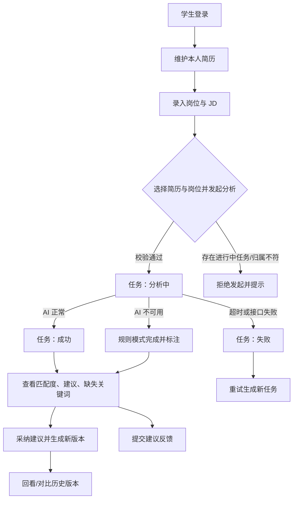

# AI 简历优化系统——需求分析说明书

> 版本：v0.10（新增简历删除/导出、修改密码）　日期：2026-11-17
> 说明：本文档依据已确认的立项范围整理。`【待确认】`表示尚未由学生或教师确认的内容，不得在开发中当作既定事实。
> 变更说明：v0.8 扩展 FR-RESUME-04（新增 DOC）、新增 FR-RESUME-05（扫描件与图片 OCR）、FR-ADMIN-03（AI 模型配置）及其 BR/AC；登录凭证改为持久化存储；原有必做/应做条目未改动。v0.9 新增 FR-CUSTOM-01～05（学生端自定义 API：配置管理、在线测试、服务端代发调用、请求头加密、控制台页面）及对应 BR/AC/追踪，本期范围增加「扩展」一行。v0.10 新增 FR-RESUME-06（简历删除与导出）、FR-USER-03（修改密码），均为扩展项，原有条目未改动。

## 1. 项目概述

### 1.1 项目背景与问题

学生本人处于实习/校招求职阶段（学生口述的真实场景）。投递不同岗位时，需要针对岗位描述（JD）反复修改同一份简历，存在以下问题：

1. 一份简历复制多份后手工修改，版本混乱，难以回看某次修改前后的内容；
2. 难以判断简历与具体 JD 的匹配程度，也不清楚 JD 中哪些关键要求没有在简历中体现；
3. 项目经历的表达缺乏参照，不知道如何改写才更有说服力。

【待确认：与同学/辅导老师的真实交流记录、同类产品的实际使用体验。不得编造“调查显示”类表述。】

### 1.2 项目目标

面向实习与校招求职学生，通过“简历录入 → 岗位 JD 录入 → AI 分析 → 建议采纳 → 版本留存”的核心流程，帮助学生获得针对具体岗位的匹配度反馈和修改建议，并保留可回溯的简历版本。

### 1.3 本期范围

| 类别 | 内容 |
| --- | --- |
| 必做 | 注册登录与角色权限；简历多模块管理（支持多份）；岗位与 JD 管理；AI 分析任务与状态流转；分析结果展示（匹配度、分模块建议、缺失关键词）；建议采纳与版本保存；历史版本回看与对比；分析记录查询 |
| 应做 | 建议有用性反馈；基础统计与质量反馈统计；AI 失败/超时的异常提示与重试；管理员用户管理、任务监管与 AI 模型配置 |
| 选做 | 岗位匹配度排序、多简历对比、PDF/DOCX/DOC/TXT 与图片简历上传解析、扫描件 OCR、模拟面试问题生成、敏感信息脱敏提醒（均已实现） |
| 扩展（v0.9） | 学生端「API 控制台」与自定义 API：配置任意 HTTP 接口、在线测试、服务端代发调用、请求头值加密存储（超出原立项范围，按使用方要求新增） |
| 本期不做 | 在线投递、企业招聘方端；真实支付与简历模板交易；多租户 SaaS、跨校数据共享；实时协作编辑与即时通信 |

## 2. 用户角色与权限

| 角色 | 使用目标 | 主要操作 | 可访问的数据 | 权限限制 |
| --- | --- | --- | --- | --- |
| 学生（求职者） | 维护本人简历，获得针对目标岗位的优化建议 | 注册登录、维护本人简历、从文件导入简历、维护岗位 JD、发起 AI 分析、查看结果、采纳建议、查看记录与版本；查看岗位匹配度、多简历对比、敏感信息提醒与模拟面试题；**配置并调用本人自定义 API** | 仅本人简历、本人岗位、本人分析记录与版本、本人自定义 API 配置 | 不能查看或修改他人数据；不能进入管理员后台；不能修改已成功的分析结果；不能读写他人自定义 API |
| 管理员 | 维护账号秩序、监管任务运行、配置文件导入与 AI 模型 | 查询用户、启用/禁用账号、查看分析任务状态、查看基础统计与质量反馈统计、切换/自定义分析模型 | 用户列表、任务状态与统计/反馈汇总信息（不含简历正文与建议全文）、模型清单与当前模型 | 不能代替学生编辑简历、不能代发起分析；看不到网关密钥；【待确认：是否允许查看简历正文与建议全文，默认不允许】 |

【待确认：是否需要“就业指导教师”角色（查看学生简历与建议记录）。当前版本不纳入，避免扩大范围。】

## 3. 核心使用场景

### SC-USER-01 注册并登录系统

- 参与角色：学生、管理员
- 触发条件：首次使用或需要进入系统
- 用户目标：获得与自身角色匹配的可用身份
- 前置条件：能访问系统登录页
- 正常过程：填写账号、密码、角色为学生的注册信息 → 提交 → 注册成功 → 使用账号登录 → 进入本人工作台
- 预期结果：账号创建成功，登录后进入对应角色首页
- 异常情况：账号已存在、必填为空、密码不符合规则时拒绝注册并指出字段；账号被禁用时拒绝登录

### SC-RESUME-01 维护个人简历

- 参与角色：学生
- 触发条件：开始投递前整理简历，或新增项目/实习经历
- 用户目标：形成一份结构化、可被 AI 分析的简历
- 前置条件：已登录
- 正常过程：进入“我的简历” → 新建简历或选择已有简历 → 填写基本信息、教育经历、项目/实习经历、技能 → 保存 → 列表显示最新更新时间
- 预期结果：简历数据保存成功，本人简历列表更新
- 异常情况：必填为空或超出长度时指出具体字段并拒绝保存；保存失败时保留已填内容

### SC-JOB-01 录入目标岗位与 JD

- 参与角色：学生
- 触发条件：准备针对某个具体岗位优化简历
- 用户目标：把目标岗位及 JD 稳定保存下来，供多次分析复用
- 前置条件：已登录
- 正常过程：进入“岗位管理” → 新建岗位 → 填写岗位名称、公司名称（可选）、JD 文本、技能关键词（可选） → 保存 → 列表显示该岗位
- 预期结果：岗位记录保存成功，可在发起分析时被选择
- 异常情况：岗位名称为空或 JD 为空时拒绝保存；JD 超出长度上限时提示上限

### SC-ANALYSIS-01 发起 AI 分析并查看结果

- 参与角色：学生
- 触发条件：已有至少一份本人简历和一个本人岗位
- 用户目标：获得简历与 JD 的匹配度、分模块修改建议和缺失关键词
- 前置条件：已登录；所选简历与岗位均属于本人且已保存；该简历没有进行中的分析任务
- 正常过程：进入“简历分析” → 选择简历与岗位 → 点击“开始分析” → 任务创建并显示“分析中” → 系统完成分析后状态变为“成功” → 页面展示匹配度、分模块建议、JD 中未覆盖的关键词
- 预期结果：新增一条分析记录，状态为成功；简历原文不被修改
- 异常情况：AI 超时或接口失败 → 任务置为“失败”并提供重试；AI 不可用 → 降级为规则模式并明确标注；同一简历已有进行中任务 → 拒绝发起并提示

### SC-VERSION-01 采纳建议并保存新版本

- 参与角色：学生
- 触发条件：某次分析成功，学生认可部分建议
- 用户目标：把建议落实到简历，同时保留修改前的版本
- 前置条件：已登录；存在本人已成功的分析记录；对应简历存在
- 正常过程：在结果页选择“采纳并生成新版本” → 系统复制当前简历内容 → 学生按建议编辑 → 填写本次修改说明 → 保存 → 版本列表新增一条记录
- 预期结果：新增版本号 +1 的简历版本，原版本仍可查看
- 异常情况：必填字段为空时拒绝保存；并发保存导致版本号冲突时拒绝并提示刷新

### SC-ADMIN-01 管理员监管用户与分析任务

- 参与角色：管理员
- 触发条件：需要处理异常账号或了解任务运行情况
- 用户目标：维护账号状态，掌握分析任务的成功与失败情况
- 前置条件：管理员已登录
- 正常过程：进入后台 → 用户列表按账号搜索 → 禁用/启用账号 → 分析任务列表按状态筛选（只读） → 查看基础统计
- 预期结果：账号状态变更立即生效；任务状态可见；统计数值与任务列表一致
- 异常情况：学生访问后台地址 → 拒绝并跳转；禁用账号后该账号无法登录与发起分析，其历史数据保留

### SC-API-01 配置并调用自定义 API

1. 学生在「API 控制台」新建配置，填写名称、请求方法、地址、请求头、查询参数与请求体；
2. 点击「测试请求」，页面展示目标服务的状态码、耗时、请求与响应，确认配置正确；
3. 保存后配置写入服务端（请求头值加密），列表可按分组/标签/关键字筛选；
4. 在结果侧栏「发起调用」或在前端脚本中通过 `Api.Custom.invoke/invokeByName` 调用；
5. 调用失败时按返回的 `status/message` 判断原因，必要时调整配置或重试。

## 4. 功能需求

### FR-USER-01 注册账号

| 项目 | 内容 |
| --- | --- |
| 来源场景 | SC-USER-01 |
| 使用角色 | 学生 |
| 前置条件 | 未登录；账号未被占用 |
| 输入 | 账号（必填）、密码（必填）、确认密码（必填）、昵称（可选） |
| 系统处理 | 校验非空、账号唯一、两次密码一致、密码长度符合规则；密码加密存储；默认角色为学生 |
| 成功结果 | 提示注册成功并跳转登录页 |
| 异常处理 | 任一校验失败时指出具体字段，不创建账号 |
| 优先级 | 必做 |

### FR-USER-02 登录与身份校验

| 项目 | 内容 |
| --- | --- |
| 来源场景 | SC-USER-01 |
| 使用角色 | 学生、管理员 |
| 前置条件 | 已注册且账号未被禁用 |
| 输入 | 账号、密码 |
| 系统处理 | 校验账号密码；校验账号状态；签发登录凭证；按角色加载可用菜单 |
| 成功结果 | 学生进入工作台，管理员进入后台首页 |
| 异常处理 | 账号或密码错误统一提示“账号或密码错误”；账号被禁用提示“账号已禁用”；均不签发凭证 |
| 优先级 | 必做 |

### FR-USER-03 修改密码（扩展）

| 项目 | 内容 |
| --- | --- |
| 来源场景 | SC-USER-01（扩展） |
| 使用角色 | 学生、管理员 |
| 前置条件 | 已登录 |
| 输入 | 原密码、新密码、确认新密码 |
| 系统处理 | 校验原密码；校验新密码长度 6~64 位且不得与原密码相同；写入新的 PBKDF2 哈希；吊销该用户全部旧凭证并签发新凭证 |
| 成功结果 | 提示修改成功，当前会话保持登录，其他设备上的登录失效 |
| 异常处理 | 原密码错误、新密码过短、新旧密码相同均给出明确提示；未登录返回 401 |
| 优先级 | 扩展 |

### FR-RESUME-01 新建与编辑简历

| 项目 | 内容 |
| --- | --- |
| 来源场景 | SC-RESUME-01 |
| 使用角色 | 学生 |
| 前置条件 | 已登录；操作对象为本人简历 |
| 输入 | 简历名称、姓名、求职意向、联系方式（可选）、教育经历、项目/实习经历、技能；各字段有长度上限 |
| 系统处理 | 校验必填与长度；保存简历及各子模块；记录更新时间 |
| 成功结果 | 保存成功，返回简历详情，列表显示最新更新时间 |
| 异常处理 | 校验失败指出具体字段并拒绝保存；保存异常时保留页面已填内容 |
| 优先级 | 必做 |

### FR-RESUME-02 查询本人简历列表

| 项目 | 内容 |
| --- | --- |
| 来源场景 | SC-RESUME-01 |
| 使用角色 | 学生 |
| 前置条件 | 已登录 |
| 输入 | 无（可选按简历名称搜索） |
| 系统处理 | 按当前登录用户过滤，按更新时间倒序返回 |
| 成功结果 | 列表仅显示本人简历及更新时间、版本数 |
| 异常处理 | 未登录或凭证失效时跳转登录；越权查询他人简历返回拒绝 |
| 优先级 | 必做 |

### FR-RESUME-03 敏感信息脱敏提醒

| 项目 | 内容 |
| --- | --- |
| 来源场景 | SC-RESUME-01（扩展） |
| 使用角色 | 学生 |
| 前置条件 | 已登录；查看或保存本人简历 |
| 输入 | 简历的联系电话、个人简介、项目/实习经历描述 |
| 系统处理 | 保存与查看详情时扫描手机号、身份证号、银行卡号；命中后生成「类型 + 所在字段 + 脱敏示例 + 建议」；仅提示，不阻断保存；接口不返回完整号码 |
| 成功结果 | 保存成功；页面展示敏感信息提醒条，注明不影响保存 |
| 异常处理 | 未命中时不展示提醒；扫描异常不影响简历保存与详情返回 |
| 优先级 | 选做 |

### FR-RESUME-04 从文件导入简历

| 项目 | 内容 |
| --- | --- |
| 来源场景 | SC-RESUME-01（扩展） |
| 使用角色 | 学生 |
| 前置条件 | 已登录；持有本人简历文件（PDF、DOCX、DOC 或 TXT） |
| 输入 | 单个文件，≤ 5MB；扩展名与实际文件头一致 |
| 系统处理 | 校验类型/大小/文件头；PDF 取前 10 页文本、DOCX 读取正文 XML（禁用 DTD/外部实体）、DOC 用 HWPF 抽取正文、TXT 兼容 UTF-8/GBK；扩展名与文件头不符时按实际格式解析；按规则识别姓名、求职意向、手机号、邮箱、简介、技能、项目；返回草稿、提示与文本预览；不保存原文件、不直接入库 |
| 成功结果 | 页面展示草稿预览，学生确认后填入表单，仍需手动保存 |
| 异常处理 | 非白名单格式、伪造文件头、超过 5MB、加密文件、损坏文件、解析失败时给出明确原因且不影响已有表单 |
| 优先级 | 选做 |

### FR-RESUME-05 扫描件与图片识别（OCR）

| 项目 | 内容 |
| --- | --- |
| 来源场景 | SC-RESUME-01（扩展） |
| 使用角色 | 学生 |
| 前置条件 | 已登录；AI 服务已启用并配置密钥（OCR 依赖多模态模型） |
| 输入 | 扫描版 PDF（无文字层）或图片简历（PNG/JPG），≤ 5MB |
| 系统处理 | 文字版 PDF 优先本地抽取；无文字层时按配置 DPI 逐页渲染为图片，最多识别 N 页（默认 3），交由多模态模型 OCR；图片直接识别；结果标注"已通过 OCR 识别"，提醒人工核对；单页图片过大时自动缩放 |
| 成功结果 | 返回与文字版一致结构的草稿（姓名/意向/联系方式/技能/项目），并附 OCR 提示 |
| 异常处理 | OCR 未启用或未配置密钥时明确提示而非静默失败；识别不到文字、模型超时/不可用时给出可操作原因；图片文件头不符时拒绝 |
| 优先级 | 选做 |

### FR-RESUME-06 简历删除与导出（扩展）

| 项目 | 内容 |
| --- | --- |
| 来源场景 | SC-RESUME-01（扩展） |
| 使用角色 | 学生 |
| 前置条件 | 已登录且拥有该简历 |
| 输入 | 简历 id（可多选，单次 ≤50）；导出格式 `md` / `txt` |
| 系统处理 | 删除前校验归属；先清理该简历关联的分析任务（RESTRICT 外键），再删除简历，版本与子模块由外键级联清除；导出按结构化数据生成 Markdown 或纯文本，文件名取姓名并过滤非法字符 |
| 成功结果 | 删除返回实际删除数与被清理的分析记录数；导出返回文件名与内容，由前端生成文件下载 |
| 异常处理 | 未选择、超过 50 份、非本人简历分别给出提示；导出他人简历返回「无权访问该简历」 |
| 优先级 | 扩展 |

### FR-JOB-01 维护岗位与 JD

| 项目 | 内容 |
| --- | --- |
| 来源场景 | SC-JOB-01 |
| 使用角色 | 学生 |
| 前置条件 | 已登录 |
| 输入 | 岗位名称（必填）、公司名称（可选）、JD 文本（必填）、技能关键词（可选） |
| 系统处理 | 校验必填与长度；保存岗位并归属当前用户 |
| 成功结果 | 岗位列表新增或更新该记录 |
| 异常处理 | 必填为空或超长时提示且不保存；编辑非本人岗位时拒绝 |
| 优先级 | 必做 |

### FR-JOB-02 岗位匹配度排序

| 项目 | 内容 |
| --- | --- |
| 来源场景 | SC-JOB-01（扩展） |
| 使用角色 | 学生 |
| 前置条件 | 已登录；至少一份本人简历与一个本人岗位 |
| 输入 | 简历 ID；可选岗位名称/公司关键词 |
| 系统处理 | 取该简历的个人简介、技能、项目名称与描述拼接为文本；对每个岗位的关键词（未填写时从 JD 抽取英文技术词）计算覆盖率；按覆盖率倒序返回，并返回命中/缺失关键词 |
| 成功结果 | 列表按匹配度从高到低展示，显示覆盖数与关键词总数 |
| 异常处理 | 使用他人简历、他人岗位时拒绝；岗位无可用关键词时匹配度显示为 0 并标注「无可识别关键词」 |
| 优先级 | 选做 |

### FR-JOB-03 多简历对比

| 项目 | 内容 |
| --- | --- |
| 来源场景 | SC-JOB-01（扩展） |
| 使用角色 | 学生 |
| 前置条件 | 已登录；本人一个岗位；本人至少两份简历 |
| 输入 | 岗位 ID；2～3 份本人简历 ID |
| 系统处理 | 校验岗位与简历归属、数量 2～3、无重复；按统一口径计算每份简历的匹配度、命中/缺失关键词，并读取完整度、技能数、项目数；按匹配度倒序，标记最匹配与完整度最高 |
| 成功结果 | 页面并列展示各份简历的匹配度、完整度、缺失关键词与差异结论 |
| 异常处理 | 少于 2 份、超过 3 份、重复选择、他人岗位/简历时拒绝并提示；不做业务写入 |
| 优先级 | 选做 |

### FR-ANALYSIS-01 发起分析任务

| 项目 | 内容 |
| --- | --- |
| 来源场景 | SC-ANALYSIS-01 |
| 使用角色 | 学生 |
| 前置条件 | 已登录；所选举简历与岗位均属于本人且已保存；该简历无进行中任务 |
| 输入 | 简历 ID、岗位 ID |
| 系统处理 | 校验归属与任务冲突；创建任务并置为“分析中”；异步调用 AI，30 秒超时；AI 不可用时切换规则模式并标记分析方式 |
| 成功结果 | 任务创建成功，记录归属当前用户；结果写入分析记录 |
| 异常处理 | 归属不符或存在进行中任务时拒绝且不创建任务；超时或接口错误置为“失败”，可重试 |
| 优先级 | 必做 |

### FR-ANALYSIS-02 查看分析结果

| 项目 | 内容 |
| --- | --- |
| 来源场景 | SC-ANALYSIS-01 |
| 使用角色 | 学生（本人任务） |
| 前置条件 | 任务状态为“成功” |
| 输入 | 任务 ID |
| 系统处理 | 校验任务归属；返回匹配度、分模块建议、缺失关键词、分析方式（AI/规则） |
| 成功结果 | 页面展示完整结果；简历内容保持不变 |
| 异常处理 | 任务非本人或不存在时拒绝；任务未成功时展示状态与重试入口而非建议内容 |
| 优先级 | 必做 |

### FR-ANALYSIS-03 查询分析记录

| 项目 | 内容 |
| --- | --- |
| 来源场景 | SC-ANALYSIS-01 |
| 使用角色 | 学生 |
| 前置条件 | 已登录 |
| 输入 | 可选按状态、时间筛选 |
| 系统处理 | 按当前用户过滤，按创建时间倒序返回任务及状态 |
| 成功结果 | 仅显示本人分析记录，可进入结果详情 |
| 异常处理 | 未登录跳转登录；查询他人记录返回拒绝 |
| 优先级 | 必做 |

### FR-ANALYSIS-04 提交建议反馈

| 项目 | 内容 |
| --- | --- |
| 来源场景 | SC-ANALYSIS-01 |
| 使用角色 | 学生 |
| 前置条件 | 本人任务状态为“成功” |
| 输入 | 反馈类型（有用/无用）、备注（可选） |
| 系统处理 | 每条任务允许提交一次反馈，可修改；记录提交时间 |
| 成功结果 | 反馈保存并显示当前反馈状态 |
| 异常处理 | 重复提交时覆盖原反馈而非新增；非本人任务拒绝 |
| 优先级 | 应做 |

### FR-VERSION-01 采纳建议生成新版本

| 项目 | 内容 |
| --- | --- |
| 来源场景 | SC-VERSION-01 |
| 使用角色 | 学生 |
| 前置条件 | 已登录；存在本人成功的分析记录；目标简历属于本人 |
| 输入 | 修改后的简历内容、本次修改说明（必填）、来源分析任务 ID |
| 系统处理 | 复制原简历为新版本；版本号在原最大版本号上 +1；关联来源任务；原版本不变 |
| 成功结果 | 新版本保存成功，版本列表新增记录 |
| 异常处理 | 必填为空或版本号冲突时拒绝保存，原版本不受影响 |
| 优先级 | 必做 |

### FR-VERSION-02 查看与对比历史版本

| 项目 | 内容 |
| --- | --- |
| 来源场景 | SC-VERSION-01 |
| 使用角色 | 学生 |
| 前置条件 | 已登录；简历存在至少一个版本 |
| 输入 | 简历 ID、两个版本号 |
| 系统处理 | 校验归属；返回两个版本的各模块内容用于对比 |
| 成功结果 | 并排展示两版本差异模块（至少覆盖教育、项目/实习、技能） |
| 异常处理 | 版本不属于本人简历时拒绝；缺少任一版本时提示不存在 |
| 优先级 | 必做 |

### FR-INTERVIEW-01 生成模拟面试问题

| 项目 | 内容 |
| --- | --- |
| 来源场景 | SC-ANALYSIS-01（扩展） |
| 使用角色 | 学生 |
| 前置条件 | 已登录；存在本人状态为「成功」的分析任务 |
| 输入 | 分析任务 ID |
| 系统处理 | 读取该任务的岗位、JD 关键词、缺失关键词与简历项目；按「项目经历 → 技术深挖 → 岗位匹配 → 反问环节」模板生成 6～10 道题，每题附回答提示；不调用大模型、不落库 |
| 成功结果 | 返回题目列表，页面以弹窗按类别展示 |
| 异常处理 | 任务非本人或不存在时拒绝；任务未成功时提示仅成功的分析可生成；岗位不存在时提示无法生成 |
| 优先级 | 选做 |

### FR-ADMIN-01 管理用户账号

| 项目 | 内容 |
| --- | --- |
| 来源场景 | SC-ADMIN-01 |
| 使用角色 | 管理员 |
| 前置条件 | 管理员已登录 |
| 输入 | 账号关键词；启用/禁用操作 |
| 系统处理 | 按关键词查询用户；变更账号状态；禁用后使该账号登录与发起分析被拒绝 |
| 成功结果 | 用户列表状态更新；被禁用账号立即无法登录 |
| 异常处理 | 学生访问该功能时拒绝；管理员不能禁用自身账号 |
| 优先级 | 应做 |

### FR-ADMIN-02 监管分析任务

| 项目 | 内容 |
| --- | --- |
| 来源场景 | SC-ADMIN-01 |
| 使用角色 | 管理员 |
| 前置条件 | 管理员已登录 |
| 输入 | 状态筛选、时间范围（可选） |
| 系统处理 | 只读查询任务列表与状态，不返回简历正文与建议全文【待确认】 |
| 成功结果 | 列表展示任务归属用户、状态、分析方式、创建时间 |
| 异常处理 | 学生访问时拒绝 |
| 优先级 | 应做 |

### FR-STAT-01 查看基础统计

| 项目 | 内容 |
| --- | --- |
| 来源场景 | SC-ADMIN-01 |
| 使用角色 | 管理员 |
| 前置条件 | 管理员已登录 |
| 输入 | 时间范围（可选） |
| 系统处理 | 统计用户数、分析任务总数、成功数、失败数、规则模式占比 |
| 成功结果 | 统计数值与任务列表一致 |
| 异常处理 | 统计服务异常时展示错误提示，不显示错误数值 |
| 优先级 | 应做 |

### FR-STAT-02 查看质量与反馈统计

| 项目 | 内容 |
| --- | --- |
| 来源场景 | SC-ADMIN-01 |
| 使用角色 | 管理员 |
| 前置条件 | 管理员已登录 |
| 输入 | 无 |
| 系统处理 | 基于成功任务聚合：反馈有用率（有用/已反馈）、反馈覆盖率（已反馈/成功任务）、AI 与规则方式的数量/占比/均分、AI 不可达降级次数、缺失关键词 Top 8；同时返回当前 AI 开关、模型、数据库版本、Token 存储方式与有效凭证数 |
| 成功结果 | 后台概览展示质量卡片、方式分布与缺失关键词；数值与任务列表、反馈数据一致 |
| 异常处理 | 学生访问拒绝；统计异常时展示错误提示，不回退为错误数值；仅返回聚合结果，不含简历正文与建议全文 |
| 优先级 | 应做 |

### FR-ADMIN-03 配置分析模型

| 项目 | 内容 |
| --- | --- |
| 来源场景 | SC-ADMIN-01（扩展） |
| 使用角色 | 管理员 |
| 前置条件 | 管理员已登录；查看模型清单需 AI 服务可用 |
| 输入 | 从网关模型清单中选择，或填写自定义模型 ID（2~80 字符）；留空表示恢复配置文件默认值 |
| 系统处理 | 服务端代理网关 `/models` 返回清单（名称、积分倍率、是否支持图片输入），缓存 10 分钟且密钥不出后端；保存到 `sys_config`，运行期立即生效并持久化；自定义模型只做格式校验 |
| 成功结果 | 后续分析使用新模型；后台与系统状态展示当前模型；服务重启后仍生效 |
| 异常处理 | 学生访问返回 403；模型 ID 格式非法时拒绝并提示；网关不可用时返回上次缓存清单并标注可能过期 |
| 优先级 | 应做 |

### FR-CUSTOM-01 管理自定义 API 配置

| 项目 | 内容 |
| --- | --- |
| 来源场景 | SC-API-01 |
| 使用角色 | 学生 |
| 前置条件 | 已登录 |
| 输入 | 名称、请求方法、地址、分组、标签、请求头、查询参数、请求体类型与内容、超时、重试次数、启用状态 |
| 系统处理 | 校验字段；新建/更新/删除/复制本人配置；按关键字、分组、标签过滤；同名与数量上限校验；所有读写按 `user_id` 隔离 |
| 成功结果 | 配置保存并返回完整结构；列表返回 `items/total/groups/tags/limit` |
| 异常处理 | 名称为空或超长、方法不合法、地址非 http(s)、请求头非法、参数类型不符、JSON 请求体非法、标签超限、重名、超过 100 个、非本人配置均拒绝并提示原因 |
| 优先级 | 应做（v0.9 扩展） |

### FR-CUSTOM-02 在线测试请求

| 项目 | 内容 |
| --- | --- |
| 来源场景 | SC-API-01 |
| 使用角色 | 学生 |
| 前置条件 | 已登录；已填写完整的请求定义 |
| 输入 | 与保存相同的配置字段（可含 `id` 以沿用已保存的敏感请求头） |
| 系统处理 | 按当前表单即时发起真实请求，不落库；由服务端代发，避免浏览器跨域；统一处理超时、重试与响应截断 |
| 成功结果 | 返回 `ok/status/statusText/durationMs/attempts`、请求回显、响应头与响应体（≤64KB） |
| 异常处理 | 目标返回 4xx/5xx 时仍返回结果结构，以 `ok=false` 与 `status` 表达；网络失败 `status=0` 并给出中文原因；配置非法时拒绝测试 |
| 优先级 | 应做（v0.9 扩展） |

### FR-CUSTOM-03 调用已保存的配置

| 项目 | 内容 |
| --- | --- |
| 来源场景 | SC-API-01 |
| 使用角色 | 学生 |
| 前置条件 | 已登录；配置存在且为本人所有并处于启用状态 |
| 输入 | 配置 ID；可选的参数、请求头、请求体覆盖项 |
| 系统处理 | 读取配置并解密请求头；合并覆盖项；补全 `Content-Type` 与 `Accept`；按配置超时与重试策略发起请求 |
| 成功结果 | 返回与在线测试一致的结果结构；前端可用 `Api.Custom.invoke` 或 `invokeByName` 调用 |
| 异常处理 | 配置不存在或非本人：拒绝；配置已停用：拒绝并提示先启用；网络异常按重试策略处理后返回原因 |
| 优先级 | 应做（v0.9 扩展） |

### FR-CUSTOM-04 请求头加密与掩码回显

| 项目 | 内容 |
| --- | --- |
| 来源场景 | SC-API-01 |
| 使用角色 | 学生（数据安全要求） |
| 前置条件 | 配置中包含请求头 |
| 输入 | 请求头名称与值 |
| 系统处理 | 保存时对请求头值做 AES-256-GCM 加密（`enc:v1:` 密文）后入库；读取时解密用于调用；接口回显时敏感头只返回掩码并标注 `masked/hasValue`；前端以 `keep=true` 表示沿用原值；启动时把历史明文加密 |
| 成功结果 | 数据库不存在明文请求头值；页面显示「已加密 + 掩码」；调用时能带上原值；不修改直接保存不会丢失原值 |
| 异常处理 | 原配置没有该请求头却提交 `keep=true` 时提示重新填写；主密钥更换导致解密失败时按空值处理并在保存时重新加密 |
| 优先级 | 应做（v0.9 扩展） |

### FR-CUSTOM-05 API 控制台页面

| 项目 | 内容 |
| --- | --- |
| 来源场景 | SC-API-01 |
| 使用角色 | 学生 |
| 前置条件 | 已登录 |
| 输入 | 页面操作：搜索、筛选、新建、编辑、测试、调用、复制、删除 |
| 系统处理 | 列表展示名称/分组/标签/方法/地址；弹窗完成配置编辑与测试；右侧展示调用结果与代码示例；云端不可用时回落到本地镜像并提示 |
| 成功结果 | 全流程可在页面完成，无需手工构造请求；页面无 JS 异常 |
| 异常处理 | 加载失败展示原因与重试入口；保存因网络失败时进入待同步队列，可手动同步 |
| 优先级 | 应做（v0.9 扩展） |

## 5. 核心业务流程与状态说明

### 5.1 核心流程

### 5.2 分析任务状态说明

| 当前状态 | 含义 | 允许操作 | 操作角色 | 下一状态 | 禁止操作 |
| --- | --- | --- | --- | --- | --- |
| 分析中 | 已创建并提交分析，尚未返回 | 等待完成、超时判定 | 学生（发起）、系统（流转） | 成功 / 失败 | 不能重复发起同一简历的任务；不能查看建议 |
| 成功 | 已生成分析结果 | 查看结果、采纳建议、提交反馈 | 学生 | 无（终态） | 不能修改结果内容；不能再次流转 |
| 失败 | 超时、接口错误或返回格式不符 | 重试 | 学生 | 新任务为“分析中”（原任务保留） | 不能查看建议；不能直接采纳 |

## 6. 业务规则与异常情况

| 编号 | 业务规则 | 对应功能 | 违反时的处理 |
| --- | --- | --- | --- |
| BR-USER-01 | 未登录不能访问简历、岗位、分析、后台等受保护功能 | FR-USER-02 | 跳转登录页，不返回业务数据 |
| BR-USER-02 | 学生只能读写本人简历、岗位、分析记录与版本 | FR-RESUME-02、FR-ANALYSIS-03、FR-VERSION-02 | 拒绝请求，数据保持不变 |
| BR-USER-03 | 管理员不能编辑学生简历、不能代发起分析 | FR-ADMIN-01、FR-ADMIN-02 | 隐藏入口且服务端拒绝 |
| BR-USER-04 | 被禁用账号不能登录，也不能发起分析 | FR-USER-02、FR-ADMIN-01 | 登录失败并提示；发起分析被拒绝 |
| BR-RESUME-01 | 简历必填：简历名称、姓名、求职意向；至少一条教育经历或项目/实习经历【待确认】 | FR-RESUME-01 | 指出具体缺失字段，不保存 |
| BR-RESUME-02 | 字段长度上限：简历名称 ≤ 50 字，姓名 ≤ 20 字，单条经历描述 ≤ 1000 字【待确认】 | FR-RESUME-01 | 提示超长字段，不保存 |
| BR-RESUME-03 | 敏感信息仅提醒不阻断：命中手机号、身份证号、银行卡号时展示脱敏示例与建议，接口不回传完整号码 | FR-RESUME-03 | 正常保存，页面显示提醒 |
| BR-RESUME-05 | 同一简历的技能不可重复（大小写不敏感）；数据库唯一约束 + 应用层去重 | FR-RESUME-01 | 自动去重后保存 |
| BR-RESUME-04 | 文件导入只生成草稿：仅支持 PDF/DOCX/DOC/TXT/PNG/JPG、≤5MB、文件头校验通过；解析结果不直接入库，需学生确认并保存 | FR-RESUME-04 | 明确原因拒绝，表单保持原内容 |
| BR-RESUME-06 | 扫描件与图片依赖多模态 OCR：文字版文件优先本地解析，OCR 仅在无文字层或图片时启用；结果必须标注“已通过 OCR 识别”并要求人工核对；未配置视觉模型时明确提示，不静默失败 | FR-RESUME-05 | 提示原因，不阻断手动填写 |
| BR-JOB-01 | 岗位名称必填且 ≤ 50 字；JD 文本必填，长度 50～5000 字【待确认】 | FR-JOB-01 | 提示具体原因，不保存 |
| BR-JOB-02 | 岗位匹配度 = 简历文本命中的 JD 关键词数 / 关键词总数（0～100），仅用于排序参考，不写入分析记录 | FR-JOB-02 | 越权使用他人数据时拒绝 |
| BR-JOB-03 | 多简历对比限 2～3 份本人简历、同一岗位；同分时按完整度排序，结果不落库 | FR-JOB-03 | 数量/归属不符时拒绝 |
| BR-INTERVIEW-01 | 模拟面试题仅由本人成功的分析任务生成，采用规则模板，不落库、不改变简历与分析结果 | FR-INTERVIEW-01 | 非本人/未成功任务拒绝生成 |
| BR-ANALYSIS-01 | 发起分析必须使用本人且已保存的简历与岗位 | FR-ANALYSIS-01 | 拒绝，不创建任务 |
| BR-ANALYSIS-02 | 同一简历同一时刻只允许 1 个“分析中”任务；服务端在事务内锁定简历行后检查并创建，保证并发请求串行化 | FR-ANALYSIS-01 | 拒绝发起并提示稍后重试 |
| BR-ANALYSIS-03 | AI 调用超时阈值 30 秒；超时判失败，可重试 | FR-ANALYSIS-01 | 任务置“失败”，提示重试 |
| BR-ANALYSIS-04 | AI 未启用（`enabled=false` 或未配置密钥）时使用规则模式：对 JD 关键词与简历技能/描述做交集与差集，结果标注“规则模式” | FR-ANALYSIS-01、FR-ANALYSIS-02 | 不中断流程，明确标注分析方式 |
| BR-ANALYSIS-05 | AI 返回内容不符合约定结构或返回 HTTP 非 2xx 时判失败，不写入建议 | FR-ANALYSIS-01 | 任务置“失败”，可重试 |
| BR-ANALYSIS-06 | 已启用但服务不可达（未启动、域名错误、连接超时）时运行期降级：任务成功、分析方式置为规则模式，并在原因中记录降级说明 | FR-ANALYSIS-01、FR-ANALYSIS-02 | 规则模式完成，页面展示降级提示 |
| BR-VERSION-01 | 采纳建议生成新版本，不覆盖原版本，版本号在原最大值上 +1；`resume.version` 必须同步为该最大值 | FR-VERSION-01 | 版本冲突时拒绝保存并提示刷新 |
| BR-VERSION-02 | 版本记录只读，不可删除【待确认】 | FR-VERSION-02 | 不提供删除入口 |
| BR-ADMIN-01 | 管理员任务列表默认不展示简历正文与建议全文【待确认】 | FR-ADMIN-02 | 仅展示任务元信息 |
| BR-ADMIN-02 | 管理员不能禁用自身账号 | FR-ADMIN-01 | 拒绝操作并提示 |
| BR-STAT-02 | 质量统计仅管理员可见，且只返回聚合值：反馈 total=useful+useless、none=成功任务-total；方式分布仅统计成功任务；不包含简历正文与建议全文 | FR-STAT-02 | 学生访问拒绝；统计异常展示错误提示 |
| BR-ADMIN-03 | 模型设置仅管理员可改：模型 ID 需匹配 `[A-Za-z0-9][A-Za-z0-9:._/-]{1,79}`；允许保存不在清单内的自定义模型；留空表示恢复配置文件默认值；网关密钥不得返回前端 | FR-ADMIN-03 | 学生 403；格式非法拒绝并提示 |
| BR-CUSTOM-01 | 自定义 API 按账号隔离：仅本人可读写，越权访问返回「无权访问该配置」 | FR-CUSTOM-01、FR-CUSTOM-03 | 拒绝请求，数据不变 |
| BR-CUSTOM-02 | 同一学生最多 100 个配置；同一学生内名称唯一且 ≤60 字；复制时自动追加「副本」并编号 | FR-CUSTOM-01 | 提示原因，不保存 |
| BR-CUSTOM-03 | 地址必须以 http:// 或 https:// 开头、含主机名、不含空白、≤500 字；方法限 GET/POST/PUT/PATCH/DELETE/HEAD/OPTIONS；`Host`、`Content-Length`、`Connection`、`Expect`、`Upgrade`、`Transfer-Encoding` 等托管头禁止手工设置 | FR-CUSTOM-01、FR-CUSTOM-02 | 拒绝保存/测试并指出字段 |
| BR-CUSTOM-04 | 请求头 ≤20 行、查询参数 ≤30 行、标签 ≤10 个；参数按声明类型（string/number/boolean/array/object）校验；JSON 请求体必须可解析；请求体 ≤20000 字 | FR-CUSTOM-01 | 拒绝并提示具体原因 |
| BR-CUSTOM-05 | 调用超时：连接 5 秒、读取 1～60 秒；仅对网络异常、429、5xx 重试，最多 3 次；响应最多保留 64KB；目标 4xx/5xx 不视为接口错误，以 `ok=false` 表达 | FR-CUSTOM-02、FR-CUSTOM-03 | 返回可读原因，不抛系统异常 |
| BR-CUSTOM-06 | 请求头值必须加密存储（AES-256-GCM）；敏感头（Authorization、Cookie、api-key 等）仅返回掩码；接口与日志不得回传明文；历史明文在启动时自动加密 | FR-CUSTOM-04 | 拒绝明文落库；解密失败按空值处理 |

## 7. 非功能要求

| 类别 | 可验证要求 |
| --- | --- |
| 登录与权限 | 受保护接口均要求登录；服务端校验数据归属，越权返回拒绝；前端隐藏不作为唯一权限手段 |
| 密码与密钥 | 密码加密存储；AI 服务密钥仅存放于后端配置或环境变量，不写入前端代码与代码仓库 |
| 输入与反馈 | 校验失败时指出具体字段；AI 失败时展示明确原因与重试入口 |
| 兼容与可用性 | 在课程指定的 Chrome / Edge 最新版本中可完成注册登录、简历维护、分析、采纳与对比全流程 |
| 响应与超时 | 普通页面操作 3 秒内返回（不含 AI 分析）；AI 分析超时 30 秒并有状态提示 |
| 数据与隐私 | 本地或内网运行；演示使用虚构简历数据；日志不记录完整手机号、身份证号等敏感信息；敏感信息提醒仅展示脱敏结果 |
| 凭据保护 | 自定义 API 的请求头值使用 AES-256-GCM 加密存储，数据库中不出现明文；接口只返回掩码；主密钥与本机密钥文件不得提交仓库 |
| 可维护性 | 分析方式（AI/规则）、任务状态、失败原因与降级原因在页面可见，便于排查 |

## 8. 验收条件

### AC-USER-01 正常登录

- 对应需求：FR-USER-02 / BR-USER-01
- 给定：存在一个未被禁用的学生账号
- 当：输入正确账号与密码并登录
- 那么：进入学生工作台，导航中不含后台管理入口

### AC-USER-02 越权访问被拒绝

- 对应需求：FR-RESUME-02 / BR-USER-02
- 给定：学生 A 已登录，学生 B 存在一份简历
- 当：A 直接请求 B 的简历详情
- 那么：请求被拒绝并提示无权访问，B 的简历数据保持不变

### AC-USER-03 禁用账号无法登录

- 对应需求：FR-ADMIN-01 / BR-USER-04
- 给定：管理员已禁用某学生账号
- 当：该学生尝试登录
- 那么：登录失败并提示账号已禁用，不签发登录凭证

### AC-RESUME-01 必填校验

- 对应需求：FR-RESUME-01 / BR-RESUME-01
- 给定：学生已登录，新建简历时求职意向为空
- 当：点击保存
- 那么：提示“求职意向不能为空”，简历未保存，列表数量不变

### AC-RESUME-02 简历保存成功

- 对应需求：FR-RESUME-01
- 给定：学生已登录，填写完整的简历名称、姓名、求职意向与一条项目经历
- 当：点击保存
- 那么：简历详情可见，列表显示最新更新时间与版本数

### AC-RESUME-03 敏感信息提醒

- 对应需求：FR-RESUME-03 / BR-RESUME-03
- 给定：学生已登录，简历个人简介中包含完整身份证号、银行卡号，联系电话为完整手机号
- 当：保存并在详情页查看该简历
- 那么：保存成功；页面显示敏感信息提醒，类型包含手机号、身份证号、银行卡号，仅展示脱敏示例；不阻断保存

### AC-RESUME-04 文件导入草稿

- 对应需求：FR-RESUME-04 / BR-RESUME-04
- 给定：学生已登录，持有一份包含姓名、求职意向、手机号、技能与项目经历的 DOCX 简历
- 当：上传该文件
- 那么：返回解析草稿并展示预览，姓名/意向/联系方式/技能/项目被正确识别；确认后填入表单，未点击保存前数据库无新增简历
- 异常：上传损坏的 DOC、伪造的 PDF、不支持的扩展名、超过 5MB 的文件时被拒绝并提示具体原因

### AC-RESUME-05 扫描件与图片识别

- 对应需求：FR-RESUME-05 / BR-RESUME-06
- 给定：学生已登录，AI 服务已启用；持有一份扫描版 PDF（无文字层）与一张简历照片
- 当：分别上传图片与扫描件 PDF
- 那么：两者都返回结构化草稿，姓名/求职意向/手机号/技能被识别，warnings 首条标明「已通过 OCR 识别」，提示核对；扫描件 PDF 走 OCR 而非报「未提取到文字」
- 异常：OCR 未启用时提示「需要视觉模型」并可继续手动填写；伪造 PNG 文件头被拒绝

### AC-JOB-01 岗位保存成功

- 对应需求：FR-JOB-01 / BR-JOB-01
- 给定：学生已登录，岗位名称与 JD 均填写且长度合法
- 当：保存岗位
- 那么：岗位列表新增该记录，可在发起分析时被选中

### AC-JOB-02 岗位匹配度排序

- 对应需求：FR-JOB-02 / BR-JOB-02
- 给定：学生已登录，有一份简历与多个岗位，其中岗位 A 的关键词全部命中简历，岗位 B 的关键词均未命中
- 当：选择该简历查看岗位匹配度
- 那么：岗位 A 排在最前且匹配度为 100，岗位 B 匹配度为 0；接口返回命中与缺失关键词；使用他人简历请求被拒绝

### AC-JOB-03 多简历对比

- 对应需求：FR-JOB-03 / BR-JOB-03
- 给定：学生已登录，拥有一个岗位与两份本人简历，其中一份技能覆盖更多 JD 关键词
- 当：在对比页选择该岗位与两份简历并开始对比
- 那么：返回两份简历的匹配度、完整度、缺失关键词，按匹配度倒序，标记最匹配与完整度最高；只选 1 份或超过 3 份时被拒绝

### AC-ANALYSIS-01 正常完成分析

- 对应需求：FR-ANALYSIS-01、FR-ANALYSIS-02 / BR-ANALYSIS-01
- 给定：学生已登录，存在本人简历与本人岗位，且该简历无进行中任务
- 当：选择简历与岗位并发起分析
- 那么：任务先显示“分析中”，完成后为“成功”，页面展示匹配度、分模块建议、缺失关键词与分析方式，简历内容未改变

### AC-ANALYSIS-02 重复发起被拒绝

- 对应需求：FR-ANALYSIS-01 / BR-ANALYSIS-02
- 给定：同一简历已有一个“分析中”任务
- 当：再次对该简历发起分析
- 那么：提示已有进行中任务，任务总数不增加

### AC-ANALYSIS-03 失败与重试

- 对应需求：FR-ANALYSIS-01 / BR-ANALYSIS-03、BR-ANALYSIS-05
- 给定：AI 接口超时、返回结构不合法或返回 HTTP 非 2xx
- 当：发起分析
- 那么：任务状态为“失败”并展示原因与重试入口；重试后生成新任务，原失败任务仍可查询

### AC-ANALYSIS-04 规则模式降级

- 对应需求：FR-ANALYSIS-01、FR-ANALYSIS-02 / BR-ANALYSIS-04、BR-ANALYSIS-06
- 给定：AI 未启用，或已启用但服务不可达
- 当：发起分析
- 那么：任务以规则模式完成，结果页标注“规则模式”，展示缺失关键词与模板化建议；服务不可达时额外展示降级原因，任务仍为成功

### AC-ANALYSIS-05 记录仅本人可见

- 对应需求：FR-ANALYSIS-03 / BR-USER-02
- 给定：学生 A 与学生 B 各自有分析记录
- 当：A 打开分析记录页
- 那么：仅列出 A 的记录，按创建时间倒序

### AC-VERSION-01 采纳生成新版本

- 对应需求：FR-VERSION-01 / BR-VERSION-01
- 给定：存在一条本人成功的分析记录，简历当前最大版本号为 1
- 当：采纳建议、填写修改说明并保存
- 那么：新增版本号 2 的版本，原版本 1 仍可查看

### AC-VERSION-02 版本对比

- 对应需求：FR-VERSION-02
- 给定：同一简历存在版本 1 与版本 2
- 当：选择两个版本进行对比
- 那么：并排展示两版本的教育、项目/实习、技能差异

### AC-INTERVIEW-01 生成模拟面试题

- 对应需求：FR-INTERVIEW-01 / BR-INTERVIEW-01
- 给定：存在一条本人状态为「成功」的分析记录
- 当：在结果页点击「模拟面试题」
- 那么：返回不少于 6 道题，覆盖项目经历、技术深挖、岗位匹配、反问环节，每题含问题与提示；失败任务或他人任务被拒绝

### AC-ADMIN-01 后台权限隔离

- 对应需求：FR-ADMIN-01、FR-ADMIN-02 / BR-USER-03
- 给定：学生账号已登录
- 当：直接访问后台用户管理地址
- 那么：拒绝访问并跳转，不显示用户列表

### AC-STAT-01 统计一致性

- 对应需求：FR-STAT-01
- 给定：系统中存在若干分析任务
- 当：管理员查看基础统计
- 那么：任务总数、成功数、失败数之和与任务列表筛选结果一致

### AC-STAT-02 质量与反馈统计

- 对应需求：FR-STAT-02 / BR-STAT-02
- 给定：系统中存在成功任务、部分已提交反馈，且存在 AI 降级任务
- 当：管理员查看质量与反馈统计
- 那么：反馈总数=有用+无用、未反馈=成功任务-已反馈；AI 与规则任务数之和等于成功任务数；Top 缺失关键词按出现次数排序；降级次数与任务列表中 reason 含「降级」的任务数一致；学生访问返回 403；系统信息中的凭证数量 ≥ 1（凭证已持久化）

### AC-ADMIN-03 切换分析模型

- 对应需求：FR-ADMIN-03 / BR-ADMIN-03
- 给定：管理员已登录，AI 网关可用
- 当：在后台选择某个模型并保存；随后选择「自定义模型」填写合法 ID 保存
- 那么：接口返回当前模型且 source=db，后续分析使用该模型；刷新页面仍显示该模型；服务重启后依然生效
- 异常：学生访问返回 403；模型 ID 含空格或非法字符时被拒绝；留空保存后恢复默认（source=config）

### AC-CUSTOM-01 新建并保存配置

- 对应需求：FR-CUSTOM-01 / BR-CUSTOM-01、BR-CUSTOM-02
- 给定：学生已登录，填写名称、GET、`http://localhost:8080/index.html`，分组与标签合法
- 当：保存配置
- 那么：列表出现该配置，返回分组、标签与请求头；同名学生再次新建被拒绝；他人账号看不到该配置

### AC-CUSTOM-02 在线测试返回状态码与耗时

- 对应需求：FR-CUSTOM-02 / BR-CUSTOM-03、BR-CUSTOM-05
- 给定：配置指向可访问地址，超时 8000 毫秒
- 当：在弹窗点击「测试请求」
- 那么：返回 `ok=true`、`status=200`、`durationMs` 与响应体；测试不写入数据库（配置总数不变）

### AC-CUSTOM-03 调用结果与失败语义

- 对应需求：FR-CUSTOM-03 / BR-CUSTOM-05
- 给定：分别配置指向 404、先 500 两次后 200、响应 2 秒的地址
- 当：逐条发起调用
- 那么：404 返回 `ok=false` 且 `attempts=1`；500 在重试 3 次后成功且 `attempts=3`；超时返回 `status=0` 且原因含「超时」；80KB 响应标记 `bodyTruncated=true`

### AC-CUSTOM-04 越权与停用

- 对应需求：FR-CUSTOM-03 / BR-CUSTOM-01
- 给定：账号 A 拥有配置，账号 B 已登录；该配置被停用
- 当：账号 B 读取/修改/删除该配置；账号 A 调用停用配置
- 那么：B 的三类操作均返回「无权访问该配置」，B 的列表不含该配置；A 调用返回「该配置已停用」

### AC-CUSTOM-05 请求头加密与掩码沿用

- 对应需求：FR-CUSTOM-04 / BR-CUSTOM-06
- 给定：配置含 `Authorization: Bearer <虚构值>`，保存成功
- 当：查看配置、直接再次保存、再发起调用
- 那么：接口只返回掩码（如 `Bear****5678`）且 `masked=true`；数据库 `headers_json` 中为 `enc:v1:` 密文、无明文；再次保存后调用仍携带原值

## 9. 需求追踪与变更记录

### 9.1 需求追踪

| 场景 | 功能需求 | 业务规则 | 验收条件 | 状态 |
| --- | --- | --- | --- | --- |
| SC-USER-01 | FR-USER-01、FR-USER-02 | BR-USER-01、BR-USER-04 | AC-USER-01、AC-USER-03 | 完整 |
| SC-RESUME-01 | FR-RESUME-01、FR-RESUME-02 | BR-RESUME-01、BR-RESUME-02、BR-RESUME-05、BR-USER-02 | AC-RESUME-01、AC-RESUME-02、AC-USER-02 | 完整 |
| SC-JOB-01 | FR-JOB-01 | BR-JOB-01 | AC-JOB-01 | 完整 |
| SC-ANALYSIS-01 | FR-ANALYSIS-01、FR-ANALYSIS-02、FR-ANALYSIS-03、FR-ANALYSIS-04 | BR-ANALYSIS-01～06 | AC-ANALYSIS-01～05 | 完整 |
| SC-VERSION-01 | FR-VERSION-01、FR-VERSION-02 | BR-VERSION-01、BR-VERSION-02 | AC-VERSION-01、AC-VERSION-02 | 完整 |
| SC-ADMIN-01 | FR-ADMIN-01、FR-ADMIN-02、FR-STAT-01、FR-STAT-02、FR-ADMIN-03 | BR-ADMIN-01、BR-ADMIN-02、BR-ADMIN-03、BR-STAT-02、BR-USER-03 | AC-ADMIN-01、AC-STAT-01、AC-STAT-02、AC-ADMIN-03 | 完整 |
| SC-RESUME-01（扩展） | FR-RESUME-03 | BR-RESUME-03 | AC-RESUME-03 | 完整（选做） |
| SC-JOB-01（扩展） | FR-JOB-02 | BR-JOB-02 | AC-JOB-02 | 完整（选做） |
| SC-ANALYSIS-01（扩展） | FR-INTERVIEW-01 | BR-INTERVIEW-01 | AC-INTERVIEW-01 | 完整（选做） |
| SC-RESUME-01（导入） | FR-RESUME-04、FR-RESUME-05 | BR-RESUME-04、BR-RESUME-06 | AC-RESUME-04、AC-RESUME-05 | 完整（选做） |
| SC-JOB-01（对比） | FR-JOB-03 | BR-JOB-03 | AC-JOB-03 | 完整（选做） |
| SC-API-01（扩展） | FR-CUSTOM-01～05 | BR-CUSTOM-01～06 | AC-CUSTOM-01～05 | 完整（v0.9 扩展） |

### 9.2 变更记录

| 日期 | 变更内容 | 原因 | 影响章节 | 确认人 |
| --- | --- | --- | --- | --- |
| 2026-10-24 | 依据已确认立项范围生成初稿 | 原需求文档缺失，原型开发前补写 | 全文 | 学生（待确认） |
| 2026-10-25 | 补充 FR-JOB-02、FR-RESUME-03、FR-INTERVIEW-01 及对应 BR/AC/追踪 | 第二阶段实现 3 项选做功能，文档与代码同步 | 1.3、4、6、8、9 | 学生（待确认） |
| 2026-10-25 | 补充 FR-RESUME-04、FR-JOB-03 及对应 BR/AC/追踪；选做项全部标记为已实现 | 第三阶段实现文件导入与多简历对比，文档与代码同步 | 1.3、2、4、6、8、9 | 学生（待确认） |
| 2026-10-25 | 细化 AI 失败语义：BR-04 限定未启用、新增 BR-06 运行期降级、BR-05 增加 HTTP 非 2xx；更新 AC-03/04 | 第四阶段完成 AI 链路联调与降级实现，文档与代码同步 | 6、8、9 | 学生（待确认） |
| 2026-10-25 | 新增 FR-STAT-02、BR-STAT-02、AC-STAT-02；管理端统计范围与系统状态纳入需求 | 第五阶段实现质量反馈看板，文档与代码同步 | 1.3、2、4、6、8、9 | 学生（待确认） |
| 2026-10-25 | 确认 AI 供应商与默认模型，关闭 Q-06；补充真实联调结果与密钥环境变量要求 | 第六阶段完成真实 AI 接入与验证 | 7、8、9、10 | 学生（待确认） |
| 2026-10-25 | 补充 BR-ANALYSIS-02 事务串行化、BR-VERSION-01 版本号同步、BR-RESUME-05 技能唯一 | 第七阶段关闭数据库审查问题，文档与实现一致 | 6、9 | 学生（待确认） |
| 2026-10-25 | 扩展 FR-RESUME-04（DOC）、新增 FR-RESUME-05（OCR）、FR-ADMIN-03（模型配置）及 BR-RESUME-06、BR-ADMIN-03、AC-RESUME-05、AC-ADMIN-03；登录凭证改为持久化 | 第八阶段完成 Token/DOC/OCR 与模型选择，文档与代码同步 | 1.3、2、4、6、8、9 | 学生（待确认） |
| 2026-11-16 | 新增 FR-CUSTOM-01～05（自定义 API 配置/测试/调用/请求头加密/控制台）及 BR-CUSTOM-01～06、AC-CUSTOM-01～05、SC-API-01；本期范围增加「扩展」行 | 第十阶段实现学生端 API 控制台并把请求头改为加密存储，文档与代码同步 | 1.3、2、3、4、6、7、8、9 | 学生（待确认） |

## 10. 待确认问题清单

| 编号 | 待确认内容 | 影响 |
| --- | --- | --- |
| Q-01 | 调研依据：与同学/辅导老师的真实交流记录 | 立项书“调研依据”章节 |
| Q-02 | 是否需要“就业指导教师”角色 | 角色表、权限与后台功能 |
| Q-03 | 简历必填项与各字段长度上限的最终取值 | FR-RESUME-01、BR-RESUME-01/02 |
| Q-04 | 管理员是否允许查看简历正文与建议全文 | FR-ADMIN-02、BR-ADMIN-01 |
| Q-05 | 简历版本是否允许删除 | FR-VERSION-02、BR-VERSION-02 |
| Q-06 | ✅ 已确认：内网 OpenAI 兼容网关（`http://ai-gateway.example.com/v1`），默认模型 `cn:deepseek-v4.1-flash`；密钥仅通过环境变量 `AI_API_KEY` 注入 | 非功能要求、部署方式 |
| Q-07 | 课程对页面数量、文档格式与提交时间的具体要求 | 原型范围与排期 |
| Q-08 | 选做功能口径：岗位匹配度是否计入正式成绩、模拟面试题是否需要保存历史 | FR-JOB-02、FR-INTERVIEW-01 |
| Q-09 | 文件导入与 OCR 的解析精度要求、原始文件留存策略（当前支持 PDF/DOCX/DOC/TXT/PNG/JPG 与扫描件 OCR；只解析不落盘，结果需人工核对） | FR-RESUME-04、FR-RESUME-05 |
| Q-10 | 自定义 API 是否纳入课程评分、是否需要保留调用历史（当前不落调用历史）；请求头加密主密钥是否需要集中托管 | FR-CUSTOM-01～05、BR-CUSTOM-05/06 |
